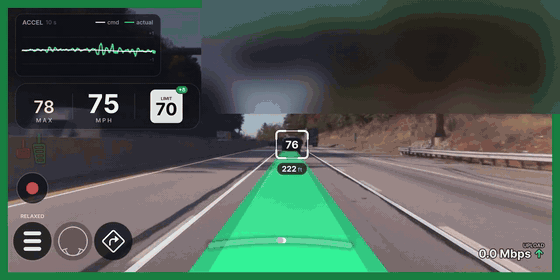

# BogPilot

BogPilot is an MIT-licensed research fork of FrogPilot, **Tesla Model S AP1 focused for now**. AP1 support is a fresh port built from BogGyver's Tinkla project, the long-standing AP1 reference. It does not reuse Model 3/Y code.

Owners of other legacy Teslas — **Pre-AP, Model X AP1, and Model S/X AP2** — are welcome to submit rlogs for fingerprinting and integration **in the future**, once all Model S AP1 features have been implemented.

**Not a product. No warranty. The driver remains responsible. Comply with local law.** Not validated as safe to drive. The maintainer has driven it on one AP1 Model S with a comma 3X, but that is a personal impression, not a bench or safety validation.

## UI demo

[](docs/media/bogpilot_ui_demo.mp4)

The current BogPilot UI replayed from a real drive log on the AP1 Model S: set speed, speed and speed limit row, live acceleration graph, path, and speed pills on tracked cars as one passes at about 115 mph. Plates are blurred. Click for the [full-quality video](docs/media/bogpilot_ui_demo.mp4).

Pinned FrogPilot SHA: `1e23dec6352cef5a36a87be0af7d7a082b7c48a4`.

## AP1 status (tag `ap1-driving-milestone-4`)

Milestone 4 (2026-10-07) is longitudinal smoothing, merged into the main branch after the maintainer's drive. It sits on top of milestone 3 (the speed-limit and stalk cruise work below).

- **Longitudinal smoothing** (AP1 only; panda safety, `ACCEL_MIN`, stopped distance and the set-speed logic are unchanged):
  - **Brake onset ramp:** regen eases in at 2 m/s³ instead of jumping in one frame; deeper requests ramp faster, and −2 m/s² or harder, FCW and stopping still go through at once.
  - **Drive release 2.0:** lifting off drive torque is a soft S-curve at 2 m/s³ (+1.3 → 0 in about 0.8 s instead of 0.25 s), so a lift no longer feels like regen grabbing.
  - **Throttle cap:** the driving model's on/off "allow throttle" hint is filtered (quick cut, slow release). Throttle/coast chatter dropped from about 24 to about 3 flips a minute on the maintainer's drives.
  - **Standstill hold:** the −1.0 m/s² hold floor was reverted after milestone 4; at a stop the request passes through to the stock −2.0 m/s² again. Launch jerk stays stock-like (1.5 m/s³).
- **Stalk / SLC refinements since milestone 3:** a tip-engage now holds through speed limit changes in both directions until you pull or disengage; tips go down to 1 mph (never 0); a posted limit under 15 mph is ignored, and a very large sudden drop must persist 2 s before SLC tracking follows it.

- Openpilot steering (angle control on `0x488`) and longitudinal control (`0x2b9`) through one harness and one panda on chassis CAN.
- **Speed limit control (SLC) raise:** with FrogPilot's Speed Limit Controller on, openpilot can set cruise above the stock limit, up to the posted limit plus your offset. From the car, SLC reads the Mobileye sign first, then the car's map limit (FrogPilot's own map sources still apply per your SLC settings).
- **Instrument cluster set speed** follows openpilot's set speed (`DAS_accSpeedLimit`, AP1 DBC scale fix), with a guard so a stopped car no longer flashes ~90 on the cluster.
- **Stalk engage** (the stalk modes below need Speed Limit Controller on; with it off, openpilot uses the car's own cruise set):
  - Tip up or down to engage: holds your **current speed**. It does not jump to the posted limit, and it stays put through speed limit changes, up or down, until you pull the stalk or disengage (curve speed control can still slow below it).
  - Pull the stalk toward you to engage: goes to the **posted limit plus your offset** and follows the limit.
- **While engaged:**
  - Tip up/down to the first position: ±1 mph.
  - Full tip (second position): next multiple of 5 up or down (50 → 55 / 50 → 45). Holding a full tip still moves one step; tip again for the next.
  - A tipped set speed stays put through speed limit zone changes, up or down, until you pull the stalk or disengage. A 15 mph school-zone tip will not pick up the next 25 or 35 sign.
  - Pull the stalk: back to the posted limit plus offset, following lower limits too (a 45 → 30 sign now follows without cancel and re-engage).
- **Experimental Mode from the stalk:**
  - Engaged: hold the stalk pulled for about 1.2 s (was 2 s).
  - Disengaged: hold the stalk forward for about 1.2 s (was 2 s).
  - A short pull and a short forward push (cancel) work as before. Known tradeoff: during the engaged hold the car's own cruise may bump its set speed, and the pull also returns openpilot to the posted limit plus offset.
- Soft steer takeover: gentle start at engage, recovery when EPAS goes inactive, grey border on wheel touch; after a firm override, 0.3 s wait (was 0.5 s) then ease back in from wherever the wheel is.
- Stalk twist changes driving personality and follow distance; Tesla Hold auto-clears when stopped behind a lead car (like Tinkla).
- Instrument cluster shows engaged state, planned path, and lane lines (`0x399`/`0x389`/`0x239`); turn off `EnableICIntegration` for the stock cluster.
- Car selection: there is no AP1 firmware table yet. The comma reads the EPS, brake booster and radar firmware, finds no match, and uses FrogPilot's saved car model (`TESLA_AP1_MODELS`) — not VIN. Other AP1 owners can submit rlogs so their versions can be added.

The full stalk map is in `docs/tesla/STALK.md`. Every place this tree knowingly differs from upstream or Tinkla is listed in `docs/tesla/DIVERGENCES.md`. Credits are in `CREDITS.md`.

### Earlier milestones

- `ap1-driving-milestone-3` (2026-10-07): SLC raise to posted limit + offset, cluster set speed, sticky stalk engage, full-tip next-5, zone-hold tips, stalk-hold Experimental toggles, 0.3 s soft-steer resume.
- `ap1-driving-milestone-2` (2026-10-05): model-path cluster lanes, FCW engage fix, grey override border, 0.5 s resume hold.
- `ap1-driving-milestone-1` (2026-10-04): first AP1 drive with openpilot steering, chassis longitudinal, hands-on pause/resume, and stalk follow profiles.

## Since milestone 4 (on `bogpilot-tesla`)

- **Blind spot (AP1):** read from the stock Autopilot status frame `0x399`, so the standard lane-change block, "Car Detected in Blindspot" alert and FrogPilot's blind spot path work. Read-only; nothing new is sent.
- **Onroad UI redesign** (Tesla-style, on by default; file toggle `RedesignUI`): speed row with MAX / speed / posted-limit tile and offset badge, steering arc (tap toggles Experimental Mode; shows driver steering), 10 s accel graph, lead box coloured by time gap with lead speed and distance tags, adjacent-lane lead speeds, and blind-spot lane fill.
- **Personality button:** tap cycles Relaxed / Standard / Aggressive; a 2.5 s hold toggles Traffic Mode.
- **Confidence ball:** port of comma's confidence ball on the right edge (green / orange / red from the model's disengage predictions). Visuals > BogPilot Confidence Ball.
- **Developer HUD:** sunnypilot-style live metrics panel (accel, lead distance and speed, steering, lateral accel). Hidden while an alert banner shows; buttons don't move.
- **Remote Screen Viewer:** view-only screen stream on port 8888 for the Tesla MCU2 browser. Device > Screen Settings.
- **AP1 driving fixes:** steering blends from the measured wheel at engage and lateral resume; one-frame radar lead glitch filter; engage below 18 mph no longer drops; standstill engage (on by default, file toggle `AP1StandstillEngage`); stalk follow-distance changes show a 1 s banner.
- **AP1 recommended toggles:** applied once when the car is set to Tesla AP1 Model S; owner changes are kept.
- **Other:** BogPilot boot logo; GPS is optional (no engage block without a modem, no "Poor GPS" banner, GPS assist data without a SIM); experimental HEVC + state stream to a computer on the same Wi-Fi (toggle `HevcStream`).

### On test branches (not on `bogpilot-tesla` yet)

- `bogpilot-tesla-cem-upload-ui`: CEM status next to the no-GPS slot, an on-screen upload-rate readout with pending backlog and ETA, and an offroad upload card (Mbps). Also: look-ahead curve brake that lands on the curve speed (Tesla only), Always On Lateral override fix for an LKAS Fault and AOL held off at parking speed, radar-only close-lead hold under a confident camera lead, quick-twist personality fix, standstill engage brake hold, and a fix for policy-head `lead_prob` being squashed twice.
- `bogpilot-tesla-upload-ui`: upload card splits pending into Logs and HEVC rows, each with an ETA.
- `bogpilot-tesla-route-stream` / `-route-stream-telemetry`: all of the above plus state-stream telemetry (rate, gaps and Wi-Fi summary every 60 s, no positions) and lead radar track IDs for smoother lead display.
- `bogpilot-tesla-bog-theme`: **The Bog**, the device web UI re-themed in BogPilot greys with the BogPilot emblem. A re-imagining of Aidenir's **The Pond**.

## Install

```
1. On the comma 3X setup screen, choose Custom Software.
2. Enter: installer.comma.ai/BogPilot/bogpilot-tesla
   (a test branch: installer.comma.ai/BogPilot/<branch name>)
3. Wait for the download and install to finish.
4. Reboot.
```

The main branch includes the SLC / stalk cruise work, the milestone 4 longitudinal smoothing and the additions above. Longitudinal control needs the DEBUG panda firmware that this branch builds. Do not enter `frogpilot.download`, which installs upstream FrogPilot.

**Coming from NotAutopilot?** Use `installer.comma.ai/BogPilot/bogpilot-tesla-notautopilot`, or switch over SSH to keep your NAP settings. See [docs/NOTAUTOPILOT.md](docs/NOTAUTOPILOT.md).

A sister AP1 port built on sunnypilot lives on `BogPilot/sunnypilot` branch `sunny-tesla`. It has not been road-tested.

---

<div align="center" style="text-align: center;">

<h1>openpilot</h1>

<p>
  <b>openpilot is an operating system for robotics.</b>
  <br>
  Currently, it upgrades the driver assistance system in 300+ supported cars.
</p>

<h3>
  <a href="https://docs.comma.ai">Docs</a>
  <span> · </span>
  <a href="https://docs.comma.ai/contributing/roadmap/">Roadmap</a>
  <span> · </span>
  <a href="https://github.com/commaai/openpilot/blob/master/docs/CONTRIBUTING.md">Contribute</a>
  <span> · </span>
  <a href="https://discord.comma.ai">Community</a>
  <span> · </span>
  <a href="https://comma.ai/shop">Try it on a comma 3X</a>
</h3>

Quick start: `bash <(curl -fsSL openpilot.comma.ai)`

[](https://github.com/commaai/openpilot/actions/workflows/selfdrive_tests.yaml)
[](LICENSE)
[](https://x.com/comma_ai)
[](https://discord.comma.ai)

</div>

<table>
  <tr>
    <td><a href="https://youtu.be/NmBfgOanCyk" title="Video By Greer Viau"></a></td>
    <td><a href="https://youtu.be/VHKyqZ7t8Gw" title="Video By Logan LeGrand"></a></td>
    <td><a href="https://youtu.be/SUIZYzxtMQs" title="A drive to Taco Bell"></a></td>
  </tr>
</table>


Using openpilot in a car
------

To use openpilot in a car, you need four things:
1. **Supported Device:** a comma 3/3X, available at [comma.ai/shop](https://comma.ai/shop/comma-3x).
2. **Software:** The setup procedure for the comma 3/3X allows users to enter a URL for custom software. Use the URL `openpilot.comma.ai` to install the release version.
3. **Supported Car:** Ensure that you have one of [the 275+ supported cars](docs/CARS.md).
4. **Car Harness:** You will also need a [car harness](https://comma.ai/shop/car-harness) to connect your comma 3/3X to your car.

We have detailed instructions for [how to install the harness and device in a car](https://comma.ai/setup). Note that it's possible to run openpilot on [other hardware](https://blog.comma.ai/self-driving-car-for-free/), although it's not plug-and-play.

------

<div align="center" style="text-align: center;">

<h1>FrogPilot 🐸</h1>

[](https://deepwiki.com/FrogAi/FrogPilot)
[](https://discord.frogpilot.com)
[](https://github.com/FrogAi/FrogPilot/releases/latest)
[](https://frogpilot.com/wiki/)

</div>

------

**FrogPilot** is a custom, community-driven, frog-themed fork of openpilot that grows and improves through the ideas and contributions of its users. It offers exciting new features and cutting-edge experiments that often arrive long before official releases. As an unofficial and highly experimental version of openpilot, **FrogPilot** should *always* be used with caution!

openpilot vs **FrogPilot**
------

#### Community
| Feature | openpilot | **FrogPilot** |
|---------|:---------:|:---------:|
| A Welcoming Community | ❌ | ✅ |
| Erich / Primary Moderators / 🦇 | ✅ | ❌ |

#### Core Features
| Feature | openpilot | **FrogPilot** |
|---------|:---------:|:---------:|
| Always On Lateral (Steering) | ❌ | ✅ |
| Blind Spot Integration | ✅ | ✅ |
| Conditional Experimental Mode | ❌ | ✅ |
| Custom Themes | ❌ | ✅ |
| Driver Monitoring | ✅ | ✅ |
| Driving Model Selector | ❌ | ✅ |
| Holiday Themes | ❌ | ✅ |
| Speed Limit Support | ❌ | ✅ |
| Weather Detection | ❌ | ✅ |

#### Device & Hardware
| Feature | openpilot | **FrogPilot** |
|---------|:---------:|:---------:|
| Advanced Volume Controller | ❌ | ✅ |
| Automatic Version Backups | ❌ | ✅ |
| C3 Support | ❌ | ✅ |
| comma Pedal Support | ❌ | ✅ |
| High Quality Recordings | ❌ | ✅ |
| SDSU Support | ❌ | ✅ |
| ZSS Support | ❌ | ✅ |

#### Gas/Brake
| Feature | openpilot | **FrogPilot** |
|---------|:---------:|:---------:|
| Adaptive Cruise Control (ACC) | ✅ | ✅ |
| Advanced Live Tuning | ❌ | ✅ |
| Custom Following Distances | ❌ | ✅ |
| Faster Human-Like Acceleration | ❌ | ✅ |
| Human-Like Speed Control in Curves | ❌ | ✅ |
| Smoother Human-Like Braking | ❌ | ✅ |

#### Steering
| Feature | openpilot | **FrogPilot** |
|---------|:---------:|:---------:|
| Advanced Live Tuning | ❌ | ✅ |
| Automatic Lane Changes | ❌ | ✅ |
| Increased Steering Torque* | ❌ | ✅ |
| Lane Centering (LKAS) | ✅ | ✅ |
| Lane Change Assist | ✅ | ✅ |

*Select vehicles only

And much much more!

🌟 Highlight Features
------

### 🚗 Always On Lateral (AOL)

With **"Always On Lateral"**, lane-centering stays active whenever cruise control is on, even when you press the accelerator or brake. This means steering assist won't cut out during manual speed adjustments giving you continuous support through curves, traffic, or mountain roads!

---

### 🧠 Conditional Experimental Mode (CEM)

**["Experimental Mode"](https://blog.comma.ai/090release/#experimental-mode)** lets openpilot drive at the speed it thinks a human would to allow slowing for curves, stopping at stoplights/stop signs, and adapting to traffic. This makes it powerful in complex scenarios, but it's still, well, "experimental" and less predictable than **"Chill Mode"**. But **"Conditional Experimental Mode"** gives you the best of both worlds by automatically switching between **"Chill Mode"** for steady cruising and **"Experimental Mode"** for more advanced situations to help fully automate your driving experience!

**"Conditional Experimental Mode"** switches into **"Experimental Mode"** when conditions like these are met:
- Approaching curves and turns
- Detecting slower or stopped lead vehicles
- Driving below a set speed
- Predicting an upcoming stop (e.g. stoplight or stop sign)

Once conditions clear it returns to **"Chill Mode"** for stability and predictability.

**Note: Stay attentive as "Experimental Mode" is an alpha feature and mistakes are expected!**

---

### 🎭 Driving Personalities

With **"Driving Personalities"**, you choose how the vehicle behaves with four adjustable profiles:

- **Traffic:** Catered towards stop-and-go traffic by minimizing gaps and delays  
- **Aggressive:** Aimed to provide tighter following distances and quicker reactions  
- **Standard:** Useful for a balanced, all-purpose driving  
- **Relaxed:** A smoother driving experience with larger following distance gaps  

Each profile can be fine-tuned to change the desired following distance, acceleration, and braking style letting you shape **FrogPilot**'s behavior to match your own driving preferences! Profiles can be switched instantly using the following distance button on the steering wheel, while **"Traffic Mode"** can be enabled by simply holding down the following distance button.

---

### 📏 Speed Limit Controller (SLC)

With **"Speed Limit Controller"**, **FrogPilot** automatically adapts to the road's posted speed using information from downloaded **["OpenStreetMap"](https://www.openstreetmap.org)** maps, online **["Mapbox"](https://www.mapbox.com)** data, and the vehicle's dashboard (if supported).

Offsets let you fine-tune how closely **FrogPilot** follows posted limits across different speed ranges allowing you to cruise slightly above or below for a more natural driving experience. If no speed limit is available, you can choose whether **FrogPilot** drives at the set speed, falls back to the last known speed limit, or uses **"Experimental Mode"** to estimate one with the driving model.

Maps can be downloaded directly in settings and updated automatically on a schedule ensuring your device always has the latest speed limits!

**Note: Speed limits are only as accurate as the available speed limit data. Always stay attentive and adjust your speed when necessary!**

---

### 🎨 Themes

With **"Themes"**, you can personalize **FrogPilot**'s driving screen to make it uniquely yours! Choose from:

- **Color Schemes**
- **Icon Packs**
- **Sound Packs**
- **Turn Signal Animations**
- **Steering Wheel Icons**

Enjoy pre-existing **FrogPilot** and seasonal holiday themes, or you can create your own with the **"Theme Maker"** and even share them with the community! For extra fun, enable features like the Mario Kart–style **"Rainbow Path"** or **"Random Events"** that add playful visual effects while you drive!

---

And lots more! From safety enhancements to personalization options, **FrogPilot** continues to evolve with features that put you in control. Check it out today for yourself!

---

🔧 Branches
------
| Branch                     | Install&nbsp;URL          | Description                                            | Recommended&nbsp;For     |
|----------------------------|---------------------------|--------------------------------------------------------|--------------------------|
| bogpilot-tesla             | `installer.comma.ai/BogPilot/bogpilot-tesla` | Main BogPilot branch (AP1 milestone 4: SLC / stalk cruise work plus longitudinal smoothing). | AP1 research, maintainer-driven |
| bogpilot-tesla-notautopilot | `installer.comma.ai/BogPilot/bogpilot-tesla-notautopilot` | bogpilot-tesla plus a one-time NotAutopilot settings import and a Tesla Car Type (Auto / AP1 / Pre-AP) page. See [docs/NOTAUTOPILOT.md](docs/NOTAUTOPILOT.md). | Owners switching from NotAutopilot |
| bogpilot-tesla-slc-raise   | `installer.comma.ai/BogPilot/bogpilot-tesla-slc-raise` | Testing branch for the SLC / stalk cruise and longitudinal smoothing work, merged into bogpilot-tesla at milestone 4. Use main. | Not needed |
| bogpilot-tesla-cluster     | `installer.comma.ai/BogPilot/bogpilot-tesla-cluster` | Older AP1 cluster work branch. Behind bogpilot-tesla; use main. | Not needed |
| FrogPilot                  | upstream FrogPilot only   | Upstream FrogPilot release name. Still accepted here.  | Not this fork            |
| FrogPilot&#8209;Staging    | upstream FrogPilot only   | Upstream beta. Not a BogPilot channel.                 | Not this fork            |
| FrogPilot&#8209;Testing    | upstream FrogPilot only   | Upstream alpha. Not a BogPilot channel.                | Not this fork            |
| FrogPilot&#8209;Development| No                        | Upstream development. Do not use.                      | Not this fork            |
| MAKE&#8209;PRS&#8209;HERE  | No                        | Workspace for pull requests. Do not use.               | Contributors             |

🧰 How to Install
------

See **Install** at the top of this page: `installer.comma.ai/BogPilot/bogpilot-tesla`. Do not enter `frogpilot.download` (or `staging.` / `testing.`), which install upstream FrogPilot.

🐞 Bug Reports / Feature Requests
------

If you run into bugs, issues, or have ideas for new features, please post about it on the **[FrogPilot Discord](https://discord.gg/frogpilot)**! Feedback helps improve **FrogPilot** and create a better experience for everyone!

To report a bug, please post it in [**#bug-reports**](https://discord.com/channels/1137853399715549214/1162100167110053888).  
To request a feature, please post it in [**#feature-requests**](https://discord.com/channels/1137853399715549214/1160318669839147259).  

Please include as much detail as possible! Photos, videos, log files, or anything that can help explain the issue or idea are very helpful!

I'll do my best to respond promptly, but not every request can be addressed right away. Your feedback is always appreciated and helps make **FrogPilot** the best it can be!

📋 Credits
------

* [Aidenir](https://github.com/Aidenir)
* [AlexandreSato](https://github.com/AlexandreSato)
* [cfranyota](https://github.com/cfranyota)
* [cydia2020](https://github.com/cydia2020)
* [dragonpilot-community](https://github.com/dragonpilot-community)
* [ErichMoraga](https://github.com/ErichMoraga)
* [garrettpall](https://github.com/garrettpall)
* [jakethesnake420](https://github.com/jakethesnake420)
* [jyoung8607](https://github.com/jyoung8607)
* [mike8643](https://github.com/mike8643)
* [neokii](https://github.com/neokii)
* [OPGM](https://github.com/opgm)
* [OPKR](https://github.com/openpilotkr)
* [pfeiferj](https://github.com/pfeiferj)
* [realfast](https://github.com/realfast)
* [syncword](https://github.com/syncword)
* [twilsonco](https://github.com/twilsonco)

Star History
------

[](https://www.star-history.com/#FrogAi/FrogPilot&Date)
